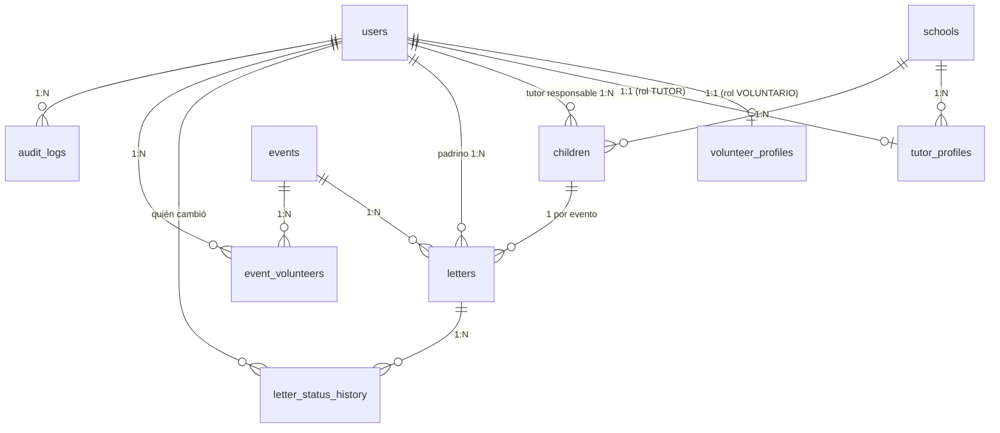
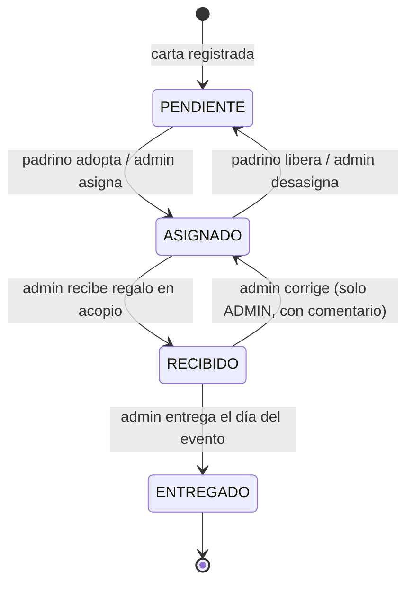

# Modelo de Datos / Esquema de Base de Datos — Soñar Despierto

> ⚠️ **Actualización 2026-10-17:** en el MVP local el motor es **SQLite** con reglas de portabilidad (ADR-0002); el DDL MySQL de §8 queda como referencia para la nube. Roles `ADMIN`/`OPERADOR` con la tabla `user_module_permissions` y `users.token_version` (ADR-0004, ADR-0007). `volunteer_profiles` y `tutor_profiles` pasarán a ser entidades independientes sin cuenta, y las FK a `users` de padrinos y tutores cambiarán (tabla de cambios en ADR-0004); esta sección se actualizará al inicio de las Fases 3 y 4. Donde haya contradicción, mandan los ADR de [`adr/`](adr/README.md).

> **Versión:** 1.0 (MVP) · **Motor:** MySQL 8.0+ · **Engine:** InnoDB · **Charset:** `utf8mb4` / `utf8mb4_0900_ai_ci`
> **Documento relacionado:** `Requerimientos_Tecnicos.md` (PRD), `API_Spec.md`, `Arquitectura_y_Convenciones.md`

---

## 1. Convenciones generales

| Convención | Regla |
|---|---|
| Nombres de tablas | `snake_case`, **plural**, en inglés (`users`, `children`, `letters`). |
| Nombres de columnas | `snake_case`, en inglés. Los textos visibles al usuario se traducen en el frontend. |
| Clave primaria | `id BIGINT UNSIGNED AUTO_INCREMENT`. |
| Claves foráneas | `<entidad_singular>_id` (ej. `school_id`). Nombre de constraint: `fk_<tabla>_<columna>`. |
| Índices | `idx_<tabla>_<columnas>`; únicos `uq_<tabla>_<columnas>`. |
| Fechas de auditoría | Toda tabla tiene `created_at` y `updated_at` (`DATETIME`, UTC). |
| Borrado | **Borrado lógico** con `is_active` en entidades con datos personales (no se pierden historiales). El borrado físico solo lo hace un administrador y sólo cuando no hay relaciones. |
| Enums | Se usan `ENUM` de MySQL con valores en MAYÚSCULAS y en español donde son estados de negocio (ej. `PENDIENTE`). El backend los refleja con `enum.Enum` de Python. |
| Zona horaria | Se guarda en UTC; el frontend muestra en `America/Mexico_City`. |

---

## 2. Diagrama entidad–relación



**Resumen de relaciones**

| Relación | Tipo | Implementación |
|---|---|---|
| `users` ↔ `volunteer_profiles` | 1:1 | `volunteer_profiles.user_id` UNIQUE + FK |
| `users` ↔ `tutor_profiles` | 1:1 | `tutor_profiles.user_id` UNIQUE + FK |
| `schools` → `tutor_profiles` | 1:N | `tutor_profiles.school_id` FK (nullable: tutor de comunidad sin escuela) |
| `schools` → `children` | 1:N | `children.school_id` FK |
| `users` (TUTOR) → `children` | 1:N | `children.tutor_user_id` FK |
| `children` ↔ `letters` | 1:1 **por evento** | `UNIQUE (child_id, event_id)` — un niño tiene una carta por cada Navidad |
| `events` → `letters` | 1:N | `letters.event_id` FK |
| `users` (padrino) → `letters` | 1:N | `letters.sponsor_user_id` FK nullable |
| `users` ↔ `events` | N:M | tabla puente `event_volunteers` |
| `letters` → `letter_status_history` | 1:N | trazabilidad del 100 % de los cambios de estatus |

> **Decisión vs. PRD:** el PRD dice "Letter 1:1 con Child". Se modela como **1:1 por evento** para que el mismo niño pueda participar en *Navidad 2026* y *Navidad 2027* sin duplicar su registro.

---

## 3. Enums / valores permitidos

| Enum | Valores | Uso |
|---|---|---|
| `user_role` | `ADMIN`, `VOLUNTARIO`, `TUTOR` | `users.role`. `ADMIN` = Coordinador General. Un padrino es un `VOLUNTARIO`. |
| `letter_status` | `PENDIENTE`, `ASIGNADO`, `RECIBIDO`, `ENTREGADO` | `letters.status` (ver máquina de estados §6). |
| `event_type` | `NAVIDAD`, `DIA_DEL_NINO`, `OTRO` | `events.event_type` |
| `event_status` | `BORRADOR`, `ABIERTO`, `EN_CURSO`, `CERRADO` | `events.status` |
| `shirt_size` | `XS`, `S`, `M`, `L`, `XL`, `XXL` | `volunteer_profiles.shirt_size` |
| `volunteer_area` | `LOGISTICA`, `GUIA_NINOS`, `ACOPIO_REGALOS`, `REGISTRO`, `ALIMENTOS`, `FOTOGRAFIA`, `PADRINO`, `OTRO` | Área de interés / área asignada |
| `participation_status` | `POSTULADO`, `CONFIRMADO`, `RECHAZADO`, `CANCELADO` | `event_volunteers.status` |
| `gender` | `NINA`, `NINO`, `OTRO`, `NO_ESPECIFICA` | `children.gender` (útil para logística de regalos) |
| `school_zone` | texto libre (no enum) | Se deja como `VARCHAR` porque las zonas cambian; se puede normalizar después. |

---

## 4. Tablas

Leyenda: **PK** clave primaria · **FK** clave foránea · **UQ** único · **NN** NOT NULL · 🔒 dato sensible

### 4.1 `users` — Cuentas de acceso

| Campo | Tipo | Null | Default | Restricciones | Notas |
|---|---|---|---|---|---|
| id | BIGINT UNSIGNED | NO | AUTO_INCREMENT | PK | |
| email | VARCHAR(255) | NO | | UQ | Se guarda en minúsculas y sin espacios. |
| password_hash | VARCHAR(255) | NO | | | 🔒 bcrypt (cost 12). **Nunca** se expone en la API. |
| role | ENUM(user_role) | NO | `'VOLUNTARIO'` | | |
| first_name | VARCHAR(80) | NO | | | |
| last_name | VARCHAR(120) | NO | | | Apellidos. |
| phone | VARCHAR(20) | SÍ | NULL | | 🔒 Formato E.164 o 10 dígitos. |
| is_active | BOOLEAN | NO | TRUE | | Cuenta deshabilitada = no puede iniciar sesión. |
| must_change_password | BOOLEAN | NO | FALSE | | TRUE cuando el admin crea la cuenta con contraseña temporal. |
| last_login_at | DATETIME | SÍ | NULL | | |
| created_at | DATETIME | NO | CURRENT_TIMESTAMP | | |
| updated_at | DATETIME | NO | CURRENT_TIMESTAMP ON UPDATE | | |

Índices: `uq_users_email (email)`, `idx_users_role_active (role, is_active)`.

### 4.2 `volunteer_profiles` — Perfil del voluntario (1:1 con `users`)

| Campo | Tipo | Null | Default | Restricciones | Notas |
|---|---|---|---|---|---|
| id | BIGINT UNSIGNED | NO | AI | PK | |
| user_id | BIGINT UNSIGNED | NO | | FK → users.id, UQ, ON DELETE CASCADE | |
| birth_date | DATE | SÍ | NULL | | 🔒 Validar mayoría de edad (≥ 15 con permiso, configurable). |
| address_city | VARCHAR(100) | SÍ | NULL | | Ciudad / municipio (no se pide domicilio completo). |
| occupation | VARCHAR(100) | SÍ | NULL | | Estudiante, profesionista, etc. |
| emergency_contact_name | VARCHAR(150) | NO | | | 🔒 |
| emergency_contact_phone | VARCHAR(20) | NO | | | 🔒 |
| emergency_contact_relationship | VARCHAR(50) | SÍ | NULL | | Ej. "Madre". |
| shirt_size | ENUM(shirt_size) | NO | | | |
| area_of_interest | ENUM(volunteer_area) | NO | | | |
| medical_notes | VARCHAR(500) | SÍ | NULL | | 🔒 Alergias/condiciones relevantes para eventos. Visible solo para ADMIN. |
| privacy_consent_at | DATETIME | NO | | | Fecha en que aceptó el aviso de privacidad. |
| created_at / updated_at | DATETIME | NO | | | |

### 4.3 `tutor_profiles` — Perfil de profesor / tutor responsable (1:1 con `users`)

| Campo | Tipo | Null | Default | Restricciones | Notas |
|---|---|---|---|---|---|
| id | BIGINT UNSIGNED | NO | AI | PK | |
| user_id | BIGINT UNSIGNED | NO | | FK → users.id, UQ, ON DELETE CASCADE | |
| school_id | BIGINT UNSIGNED | SÍ | NULL | FK → schools.id, ON DELETE SET NULL | NULL = tutor de comunidad/colonia sin escuela. |
| position | VARCHAR(80) | SÍ | NULL | | "Profesor 3°A", "Director", "Líder comunitario". |
| created_at / updated_at | DATETIME | NO | | | |

### 4.4 `schools` — Escuelas o comunidades

| Campo | Tipo | Null | Default | Restricciones | Notas |
|---|---|---|---|---|---|
| id | BIGINT UNSIGNED | NO | AI | PK | |
| name | VARCHAR(150) | NO | | | |
| cct | VARCHAR(15) | SÍ | NULL | UQ | Clave de Centro de Trabajo SEP (si aplica). Ayuda a evitar duplicados. |
| zone | VARCHAR(100) | SÍ | NULL | | Zona / colonia / municipio. |
| address | VARCHAR(255) | SÍ | NULL | | |
| contact_name | VARCHAR(150) | SÍ | NULL | | Profesor de contacto (puede no tener cuenta). |
| contact_phone | VARCHAR(20) | SÍ | NULL | | 🔒 |
| is_active | BOOLEAN | NO | TRUE | | |
| created_at / updated_at | DATETIME | NO | | | |

Índices: `uq_schools_cct (cct)`, `uq_schools_name_zone (name, zone)`.

### 4.5 `children` — Niños beneficiarios 🔒 (tabla más sensible)

| Campo | Tipo | Null | Default | Restricciones | Notas |
|---|---|---|---|---|---|
| id | BIGINT UNSIGNED | NO | AI | PK | |
| first_name | VARCHAR(80) | NO | | | 🔒 |
| last_name | VARCHAR(120) | NO | | | 🔒 Nunca visible para padrinos. |
| birth_date | DATE | NO | | | 🔒 A padrinos solo se muestra la **edad**. |
| gender | ENUM(gender) | NO | `'NO_ESPECIFICA'` | | |
| school_id | BIGINT UNSIGNED | SÍ | NULL | FK → schools.id, ON DELETE RESTRICT | |
| grade | VARCHAR(20) | SÍ | NULL | | "3° primaria". |
| group_name | VARCHAR(10) | SÍ | NULL | | "A", "B". |
| tutor_user_id | BIGINT UNSIGNED | NO | | FK → users.id, ON DELETE RESTRICT | Usuario TUTOR responsable del registro. |
| guardian_name | VARCHAR(150) | NO | | | 🔒 Padre/madre/tutor legal. |
| guardian_phone | VARCHAR(20) | SÍ | NULL | | 🔒 |
| guardian_consent | BOOLEAN | NO | FALSE | | Autorización de participación y manejo de datos. **Debe ser TRUE** para crear cartas. |
| guardian_consent_at | DATETIME | SÍ | NULL | | |
| notes | VARCHAR(500) | SÍ | NULL | | 🔒 Observaciones (alergias, etc.). Solo ADMIN/TUTOR. |
| is_active | BOOLEAN | NO | TRUE | | |
| created_by | BIGINT UNSIGNED | NO | | FK → users.id | Quién capturó. |
| created_at / updated_at | DATETIME | NO | | | |

Índices:
- `uq_children_identity (first_name, last_name, birth_date, school_id)` — evita duplicados (criterio de éxito del PRD).
- `idx_children_school (school_id)`, `idx_children_tutor (tutor_user_id)`, `idx_children_last_name (last_name)`.

> Nota: `school_id` NULL hace que el UNIQUE no aplique (MySQL permite varios NULL). El backend hace una verificación adicional de duplicados por nombre + fecha de nacimiento cuando `school_id` es NULL.

### 4.6 `events` — Eventos masivos

| Campo | Tipo | Null | Default | Restricciones | Notas |
|---|---|---|---|---|---|
| id | BIGINT UNSIGNED | NO | AI | PK | |
| name | VARCHAR(120) | NO | | UQ | "Navidad 2026". |
| event_type | ENUM(event_type) | NO | | | |
| code_prefix | VARCHAR(10) | NO | | UQ | Prefijo para códigos de carta, ej. `NAV26`. |
| event_date | DATE | NO | | | Día del evento / entrega. |
| location | VARCHAR(255) | SÍ | NULL | | |
| status | ENUM(event_status) | NO | `'BORRADOR'` | | |
| max_letters_per_sponsor | TINYINT UNSIGNED | NO | 3 | | Límite de cartas que puede adoptar un padrino. |
| description | TEXT | SÍ | NULL | | |
| created_at / updated_at | DATETIME | NO | | | |

### 4.7 `letters` — Cartas digitales y regalos

| Campo | Tipo | Null | Default | Restricciones | Notas |
|---|---|---|---|---|---|
| id | BIGINT UNSIGNED | NO | AI | PK | |
| code | VARCHAR(20) | NO | | UQ | Código único legible: `{code_prefix}-{000001}` (ej. `NAV26-000123`). Generado por el backend. |
| child_id | BIGINT UNSIGNED | NO | | FK → children.id, ON DELETE RESTRICT | |
| event_id | BIGINT UNSIGNED | NO | | FK → events.id, ON DELETE RESTRICT | Debe ser de tipo `NAVIDAD` en el MVP. |
| main_wish | VARCHAR(255) | NO | | | Deseo principal. |
| secondary_wish | VARCHAR(255) | SÍ | NULL | | |
| letter_text | TEXT | SÍ | NULL | | Transcripción opcional de la carta. |
| photo_path | VARCHAR(255) | SÍ | NULL | | Ruta relativa del archivo en el almacenamiento (no la imagen en la BD). |
| status | ENUM(letter_status) | NO | `'PENDIENTE'` | | |
| sponsor_user_id | BIGINT UNSIGNED | SÍ | NULL | FK → users.id, ON DELETE RESTRICT | Padrino. NULL si `PENDIENTE`. |
| assigned_at | DATETIME | SÍ | NULL | | |
| received_at | DATETIME | SÍ | NULL | | Regalo recibido en centro de acopio. |
| delivered_at | DATETIME | SÍ | NULL | | Entregado al niño. |
| gift_notes | VARCHAR(500) | SÍ | NULL | | Observaciones del regalo (ej. "Se cambió por talla"). |
| version | INT UNSIGNED | NO | 1 | | Bloqueo optimista (evita que dos padrinos adopten la misma carta). |
| created_by | BIGINT UNSIGNED | NO | | FK → users.id | |
| created_at / updated_at | DATETIME | NO | | | |

Índices:
- `uq_letters_code (code)`
- `uq_letters_child_event (child_id, event_id)`
- `idx_letters_event_status (event_id, status)` — listado de cartas disponibles (consulta más frecuente).
- `idx_letters_sponsor (sponsor_user_id)`

**Reglas de integridad (validadas en backend):**
- `status = 'PENDIENTE'` ⇒ `sponsor_user_id IS NULL`.
- `status IN ('ASIGNADO','RECIBIDO','ENTREGADO')` ⇒ `sponsor_user_id IS NOT NULL`.
- MySQL 8.0.16+ permite reforzarlo con `CHECK` (ver DDL).

### 4.8 `letter_status_history` — Trazabilidad de cartas

| Campo | Tipo | Null | Default | Restricciones | Notas |
|---|---|---|---|---|---|
| id | BIGINT UNSIGNED | NO | AI | PK | |
| letter_id | BIGINT UNSIGNED | NO | | FK → letters.id, ON DELETE CASCADE | |
| from_status | ENUM(letter_status) | SÍ | NULL | | NULL en la creación. |
| to_status | ENUM(letter_status) | NO | | | |
| changed_by | BIGINT UNSIGNED | NO | | FK → users.id | |
| sponsor_user_id | BIGINT UNSIGNED | SÍ | NULL | | Padrino en ese momento (copia histórica). |
| comment | VARCHAR(255) | SÍ | NULL | | |
| created_at | DATETIME | NO | CURRENT_TIMESTAMP | | |

Índice: `idx_lsh_letter (letter_id, created_at)`. **Tabla de solo inserción** (nunca se actualiza ni borra desde la API).

### 4.9 `event_volunteers` — Participación de voluntarios en eventos (N:M)

| Campo | Tipo | Null | Default | Restricciones | Notas |
|---|---|---|---|---|---|
| id | BIGINT UNSIGNED | NO | AI | PK | |
| event_id | BIGINT UNSIGNED | NO | | FK → events.id, ON DELETE CASCADE | |
| user_id | BIGINT UNSIGNED | NO | | FK → users.id, ON DELETE CASCADE | |
| requested_area | ENUM(volunteer_area) | NO | | | Área a la que se postula. |
| assigned_area | ENUM(volunteer_area) | SÍ | NULL | | Área que asigna el coordinador. |
| status | ENUM(participation_status) | NO | `'POSTULADO'` | | |
| checked_in_at | DATETIME | SÍ | NULL | | Reservado para Fase 2 (check-in). |
| created_at / updated_at | DATETIME | NO | | | |

Índices: `uq_event_volunteers (event_id, user_id)`, `idx_ev_event_status (event_id, status)`.

### 4.10 `audit_logs` — Bitácora de accesos/cambios a datos sensibles

| Campo | Tipo | Null | Default | Notas |
|---|---|---|---|---|
| id | BIGINT UNSIGNED | NO | AI | PK |
| user_id | BIGINT UNSIGNED | SÍ | NULL | FK → users.id, ON DELETE SET NULL |
| action | VARCHAR(30) | NO | | `CREATE`, `UPDATE`, `DELETE`, `EXPORT`, `LOGIN`, `LOGIN_FAILED` |
| entity | VARCHAR(50) | NO | | `children`, `letters`, `users`… |
| entity_id | BIGINT UNSIGNED | SÍ | NULL | |
| detail | JSON | SÍ | NULL | Campos cambiados (**sin** contraseñas ni datos sensibles completos). |
| ip_address | VARCHAR(45) | SÍ | NULL | |
| created_at | DATETIME | NO | CURRENT_TIMESTAMP | |

Índices: `idx_audit_entity (entity, entity_id)`, `idx_audit_user_date (user_id, created_at)`.

---

## 5. Entidades reservadas para Fase 2 (no se crean en el MVP)

| Tabla | Propósito |
|---|---|
| `child_guide_assignments` | Matchmaking niño ↔ voluntario guía por evento (`event_id`, `child_id`, `guide_user_id`, UQ `(event_id, child_id)`). |
| `child_attendance` | Check-in de niños por evento (`event_id`, `child_id`, `checked_in_at`, `checked_in_by`). |
| `refresh_tokens` | Solo si se requiere revocar sesiones individualmente. |

---

## 6. Máquina de estados de `letters.status`



- Toda transición inserta una fila en `letter_status_history` **en la misma transacción**.
- La adopción usa `SELECT ... FOR UPDATE` (o `version`) para evitar doble adopción.
- Un padrino no puede superar `events.max_letters_per_sponsor` cartas en estado `ASIGNADO`/`RECIBIDO`/`ENTREGADO` dentro del mismo evento.

---

## 7. Notas de seguridad y privacidad (datos de menores)

| Nivel | Campos | Quién puede verlos |
|---|---|---|
| **Crítico** | `children.last_name`, `birth_date`, `guardian_*`, `notes`; `volunteer_profiles.medical_notes` | ADMIN; TUTOR solo de **sus** niños. |
| **Sensible** | Teléfonos, contactos de emergencia, `users.email` de terceros | ADMIN; el propio dueño. |
| **Restringido** | Vista pública de carta para padrino: `code`, `children.first_name`, **edad** calculada, `gender`, `grade`, deseos, foto | VOLUNTARIO autenticado. Nunca apellido, escuela exacta, fecha de nacimiento ni datos del tutor. |
| **Secreto** | `users.password_hash` | Nadie (jamás sale de la BD). |

Medidas:
1. Contraseñas con **bcrypt** (cost ≥ 12).
2. Las fotos de cartas se guardan fuera de la carpeta pública y se sirven por un endpoint autenticado; nombre de archivo aleatorio (UUID). **Recomendación:** la foto no debe mostrar el apellido ni la escuela del niño (tachar antes de subir).
3. Usuario de MySQL de la aplicación con permisos mínimos (`SELECT, INSERT, UPDATE, DELETE` sobre la BD; sin `DROP`/`GRANT`).
4. Respaldos cifrados y conexión TLS a la BD en producción.
5. Toda exportación de datos de niños se registra en `audit_logs` (`action = 'EXPORT'`).
6. Cumplimiento con la **LFPDPPP** (México): aviso de privacidad y consentimiento del tutor (`guardian_consent`).

---

## 8. DDL de referencia (MySQL 8)

```sql
CREATE DATABASE IF NOT EXISTS sonar_despierto
  CHARACTER SET utf8mb4 COLLATE utf8mb4_0900_ai_ci;
USE sonar_despierto;

CREATE TABLE users (
  id BIGINT UNSIGNED AUTO_INCREMENT PRIMARY KEY,
  email VARCHAR(255) NOT NULL,
  password_hash VARCHAR(255) NOT NULL,
  role ENUM('ADMIN','VOLUNTARIO','TUTOR') NOT NULL DEFAULT 'VOLUNTARIO',
  first_name VARCHAR(80) NOT NULL,
  last_name VARCHAR(120) NOT NULL,
  phone VARCHAR(20) NULL,
  is_active BOOLEAN NOT NULL DEFAULT TRUE,
  must_change_password BOOLEAN NOT NULL DEFAULT FALSE,
  last_login_at DATETIME NULL,
  created_at DATETIME NOT NULL DEFAULT CURRENT_TIMESTAMP,
  updated_at DATETIME NOT NULL DEFAULT CURRENT_TIMESTAMP ON UPDATE CURRENT_TIMESTAMP,
  CONSTRAINT uq_users_email UNIQUE (email),
  INDEX idx_users_role_active (role, is_active)
) ENGINE=InnoDB;

CREATE TABLE schools (
  id BIGINT UNSIGNED AUTO_INCREMENT PRIMARY KEY,
  name VARCHAR(150) NOT NULL,
  cct VARCHAR(15) NULL,
  zone VARCHAR(100) NULL,
  address VARCHAR(255) NULL,
  contact_name VARCHAR(150) NULL,
  contact_phone VARCHAR(20) NULL,
  is_active BOOLEAN NOT NULL DEFAULT TRUE,
  created_at DATETIME NOT NULL DEFAULT CURRENT_TIMESTAMP,
  updated_at DATETIME NOT NULL DEFAULT CURRENT_TIMESTAMP ON UPDATE CURRENT_TIMESTAMP,
  CONSTRAINT uq_schools_cct UNIQUE (cct),
  CONSTRAINT uq_schools_name_zone UNIQUE (name, zone)
) ENGINE=InnoDB;

CREATE TABLE volunteer_profiles (
  id BIGINT UNSIGNED AUTO_INCREMENT PRIMARY KEY,
  user_id BIGINT UNSIGNED NOT NULL,
  birth_date DATE NULL,
  address_city VARCHAR(100) NULL,
  occupation VARCHAR(100) NULL,
  emergency_contact_name VARCHAR(150) NOT NULL,
  emergency_contact_phone VARCHAR(20) NOT NULL,
  emergency_contact_relationship VARCHAR(50) NULL,
  shirt_size ENUM('XS','S','M','L','XL','XXL') NOT NULL,
  area_of_interest ENUM('LOGISTICA','GUIA_NINOS','ACOPIO_REGALOS','REGISTRO','ALIMENTOS','FOTOGRAFIA','PADRINO','OTRO') NOT NULL,
  medical_notes VARCHAR(500) NULL,
  privacy_consent_at DATETIME NOT NULL,
  created_at DATETIME NOT NULL DEFAULT CURRENT_TIMESTAMP,
  updated_at DATETIME NOT NULL DEFAULT CURRENT_TIMESTAMP ON UPDATE CURRENT_TIMESTAMP,
  CONSTRAINT uq_volunteer_profiles_user UNIQUE (user_id),
  CONSTRAINT fk_volunteer_profiles_user FOREIGN KEY (user_id) REFERENCES users(id) ON DELETE CASCADE
) ENGINE=InnoDB;

CREATE TABLE tutor_profiles (
  id BIGINT UNSIGNED AUTO_INCREMENT PRIMARY KEY,
  user_id BIGINT UNSIGNED NOT NULL,
  school_id BIGINT UNSIGNED NULL,
  position VARCHAR(80) NULL,
  created_at DATETIME NOT NULL DEFAULT CURRENT_TIMESTAMP,
  updated_at DATETIME NOT NULL DEFAULT CURRENT_TIMESTAMP ON UPDATE CURRENT_TIMESTAMP,
  CONSTRAINT uq_tutor_profiles_user UNIQUE (user_id),
  CONSTRAINT fk_tutor_profiles_user FOREIGN KEY (user_id) REFERENCES users(id) ON DELETE CASCADE,
  CONSTRAINT fk_tutor_profiles_school FOREIGN KEY (school_id) REFERENCES schools(id) ON DELETE SET NULL
) ENGINE=InnoDB;

CREATE TABLE children (
  id BIGINT UNSIGNED AUTO_INCREMENT PRIMARY KEY,
  first_name VARCHAR(80) NOT NULL,
  last_name VARCHAR(120) NOT NULL,
  birth_date DATE NOT NULL,
  gender ENUM('NINA','NINO','OTRO','NO_ESPECIFICA') NOT NULL DEFAULT 'NO_ESPECIFICA',
  school_id BIGINT UNSIGNED NULL,
  grade VARCHAR(20) NULL,
  group_name VARCHAR(10) NULL,
  tutor_user_id BIGINT UNSIGNED NOT NULL,
  guardian_name VARCHAR(150) NOT NULL,
  guardian_phone VARCHAR(20) NULL,
  guardian_consent BOOLEAN NOT NULL DEFAULT FALSE,
  guardian_consent_at DATETIME NULL,
  notes VARCHAR(500) NULL,
  is_active BOOLEAN NOT NULL DEFAULT TRUE,
  created_by BIGINT UNSIGNED NOT NULL,
  created_at DATETIME NOT NULL DEFAULT CURRENT_TIMESTAMP,
  updated_at DATETIME NOT NULL DEFAULT CURRENT_TIMESTAMP ON UPDATE CURRENT_TIMESTAMP,
  CONSTRAINT uq_children_identity UNIQUE (first_name, last_name, birth_date, school_id),
  CONSTRAINT fk_children_school FOREIGN KEY (school_id) REFERENCES schools(id) ON DELETE RESTRICT,
  CONSTRAINT fk_children_tutor FOREIGN KEY (tutor_user_id) REFERENCES users(id) ON DELETE RESTRICT,
  CONSTRAINT fk_children_created_by FOREIGN KEY (created_by) REFERENCES users(id),
  INDEX idx_children_school (school_id),
  INDEX idx_children_tutor (tutor_user_id),
  INDEX idx_children_last_name (last_name)
) ENGINE=InnoDB;

CREATE TABLE events (
  id BIGINT UNSIGNED AUTO_INCREMENT PRIMARY KEY,
  name VARCHAR(120) NOT NULL,
  event_type ENUM('NAVIDAD','DIA_DEL_NINO','OTRO') NOT NULL,
  code_prefix VARCHAR(10) NOT NULL,
  event_date DATE NOT NULL,
  location VARCHAR(255) NULL,
  status ENUM('BORRADOR','ABIERTO','EN_CURSO','CERRADO') NOT NULL DEFAULT 'BORRADOR',
  max_letters_per_sponsor TINYINT UNSIGNED NOT NULL DEFAULT 3,
  description TEXT NULL,
  created_at DATETIME NOT NULL DEFAULT CURRENT_TIMESTAMP,
  updated_at DATETIME NOT NULL DEFAULT CURRENT_TIMESTAMP ON UPDATE CURRENT_TIMESTAMP,
  CONSTRAINT uq_events_name UNIQUE (name),
  CONSTRAINT uq_events_code_prefix UNIQUE (code_prefix)
) ENGINE=InnoDB;

CREATE TABLE letters (
  id BIGINT UNSIGNED AUTO_INCREMENT PRIMARY KEY,
  code VARCHAR(20) NOT NULL,
  child_id BIGINT UNSIGNED NOT NULL,
  event_id BIGINT UNSIGNED NOT NULL,
  main_wish VARCHAR(255) NOT NULL,
  secondary_wish VARCHAR(255) NULL,
  letter_text TEXT NULL,
  photo_path VARCHAR(255) NULL,
  status ENUM('PENDIENTE','ASIGNADO','RECIBIDO','ENTREGADO') NOT NULL DEFAULT 'PENDIENTE',
  sponsor_user_id BIGINT UNSIGNED NULL,
  assigned_at DATETIME NULL,
  received_at DATETIME NULL,
  delivered_at DATETIME NULL,
  gift_notes VARCHAR(500) NULL,
  version INT UNSIGNED NOT NULL DEFAULT 1,
  created_by BIGINT UNSIGNED NOT NULL,
  created_at DATETIME NOT NULL DEFAULT CURRENT_TIMESTAMP,
  updated_at DATETIME NOT NULL DEFAULT CURRENT_TIMESTAMP ON UPDATE CURRENT_TIMESTAMP,
  CONSTRAINT uq_letters_code UNIQUE (code),
  CONSTRAINT uq_letters_child_event UNIQUE (child_id, event_id),
  CONSTRAINT fk_letters_child FOREIGN KEY (child_id) REFERENCES children(id) ON DELETE RESTRICT,
  CONSTRAINT fk_letters_event FOREIGN KEY (event_id) REFERENCES events(id) ON DELETE RESTRICT,
  CONSTRAINT fk_letters_sponsor FOREIGN KEY (sponsor_user_id) REFERENCES users(id) ON DELETE RESTRICT,
  CONSTRAINT fk_letters_created_by FOREIGN KEY (created_by) REFERENCES users(id),
  CONSTRAINT chk_letters_sponsor CHECK (
    (status = 'PENDIENTE' AND sponsor_user_id IS NULL) OR
    (status <> 'PENDIENTE' AND sponsor_user_id IS NOT NULL)
  ),
  INDEX idx_letters_event_status (event_id, status),
  INDEX idx_letters_sponsor (sponsor_user_id)
) ENGINE=InnoDB;
-- Nota: MySQL no permite CHECK sobre columnas con FK "ON DELETE SET NULL",
-- por eso fk_letters_sponsor usa RESTRICT (los usuarios se desactivan, no se borran).

CREATE TABLE letter_status_history (
  id BIGINT UNSIGNED AUTO_INCREMENT PRIMARY KEY,
  letter_id BIGINT UNSIGNED NOT NULL,
  from_status ENUM('PENDIENTE','ASIGNADO','RECIBIDO','ENTREGADO') NULL,
  to_status ENUM('PENDIENTE','ASIGNADO','RECIBIDO','ENTREGADO') NOT NULL,
  changed_by BIGINT UNSIGNED NOT NULL,
  sponsor_user_id BIGINT UNSIGNED NULL,
  comment VARCHAR(255) NULL,
  created_at DATETIME NOT NULL DEFAULT CURRENT_TIMESTAMP,
  CONSTRAINT fk_lsh_letter FOREIGN KEY (letter_id) REFERENCES letters(id) ON DELETE CASCADE,
  CONSTRAINT fk_lsh_changed_by FOREIGN KEY (changed_by) REFERENCES users(id),
  INDEX idx_lsh_letter (letter_id, created_at)
) ENGINE=InnoDB;

CREATE TABLE event_volunteers (
  id BIGINT UNSIGNED AUTO_INCREMENT PRIMARY KEY,
  event_id BIGINT UNSIGNED NOT NULL,
  user_id BIGINT UNSIGNED NOT NULL,
  requested_area ENUM('LOGISTICA','GUIA_NINOS','ACOPIO_REGALOS','REGISTRO','ALIMENTOS','FOTOGRAFIA','PADRINO','OTRO') NOT NULL,
  assigned_area ENUM('LOGISTICA','GUIA_NINOS','ACOPIO_REGALOS','REGISTRO','ALIMENTOS','FOTOGRAFIA','PADRINO','OTRO') NULL,
  status ENUM('POSTULADO','CONFIRMADO','RECHAZADO','CANCELADO') NOT NULL DEFAULT 'POSTULADO',
  checked_in_at DATETIME NULL,
  created_at DATETIME NOT NULL DEFAULT CURRENT_TIMESTAMP,
  updated_at DATETIME NOT NULL DEFAULT CURRENT_TIMESTAMP ON UPDATE CURRENT_TIMESTAMP,
  CONSTRAINT uq_event_volunteers UNIQUE (event_id, user_id),
  CONSTRAINT fk_ev_event FOREIGN KEY (event_id) REFERENCES events(id) ON DELETE CASCADE,
  CONSTRAINT fk_ev_user FOREIGN KEY (user_id) REFERENCES users(id) ON DELETE CASCADE,
  INDEX idx_ev_event_status (event_id, status)
) ENGINE=InnoDB;

CREATE TABLE audit_logs (
  id BIGINT UNSIGNED AUTO_INCREMENT PRIMARY KEY,
  user_id BIGINT UNSIGNED NULL,
  action VARCHAR(30) NOT NULL,
  entity VARCHAR(50) NOT NULL,
  entity_id BIGINT UNSIGNED NULL,
  detail JSON NULL,
  ip_address VARCHAR(45) NULL,
  created_at DATETIME NOT NULL DEFAULT CURRENT_TIMESTAMP,
  CONSTRAINT fk_audit_user FOREIGN KEY (user_id) REFERENCES users(id) ON DELETE SET NULL,
  INDEX idx_audit_entity (entity, entity_id),
  INDEX idx_audit_user_date (user_id, created_at)
) ENGINE=InnoDB;
```

---

## 9. Datos semilla (seed) mínimos

1. Un usuario `ADMIN` inicial (correo y contraseña desde variables de entorno, `must_change_password = TRUE`).
2. Evento `Navidad 2026` (`NAVIDAD`, `code_prefix = 'NAV26'`, `status = 'ABIERTO'`).
3. Para desarrollo (nunca en producción): 2 escuelas, 1 tutor, 10 niños ficticios, 10 cartas, 3 voluntarios.
