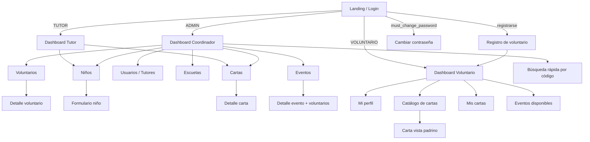

# Pantallas y Estructura de UI (MVP) — Soñar Despierto

> 🔄 **Actualización 2026-10-23 (ADR-0009):** el frontend vuelve a ser **HTML + CSS + JavaScript sin frameworks** (como SEMA), con el diseño de Lovable recreado en CSS propio. Hay dos páginas: `/` (login) y `/app`; dentro de `/app` cada pantalla es una vista por hash (`/app#cartas`, `/app#perfil`, `/app#cambiar-contrasena`…), definida en `public/js/access.js`. Donde este documento diga `/app/<ruta>`, léase `/app#<ruta>`.

> ⚠️ **Actualización 2026-10-17:** el frontend es una SPA React basada en el diseño de Lovable (ADR-0001); las rutas `.html` se reinterpretan como rutas `/app/...` (ver `fases/Fase_1_Prompts_Task_Document.md` §3.9). En el MVP local solo acceden ADMIN y OPERADOR (ADR-0004): las pantallas de voluntario y tutor con cuenta propia (P02, P06, P07, P19–P21, P24) quedan para la fase de nube y su función la opera el personal. Donde haya contradicción, mandan los ADR de [`adr/`](adr/README.md).

> ✅ **Pantallas vigentes (Fases 1–3, 2026-10-29):** la tabla siguiente lista las pantallas construidas y su ruta real. Las descripciones P01–P24 de §3 son el diseño original; para las pantallas ya construidas mandan esta tabla y los documentos de fase.

| Pantalla | Ruta | Acceso | Notas |
|---|---|---|---|
| P01 Login | `/` | 🌐 | Enlace "¿No tienes cuenta? **Solicítala aquí**" si `REGISTRATION_ENABLED=true`; aviso informativo (amarillo) si la cuenta está pendiente |
| P02 Solicitud de cuenta del personal (reinterpreta "Registro de voluntario") | `/registro` | 🌐 | Datos, contraseña con indicador de seguridad, selector de módulos (con insignia "Datos de menores" en Beneficiarios), nota y compromiso de confidencialidad → "¡Solicitud enviada!" |
| P03 Mi perfil | `/app#perfil` | 🔑 | Nombre, apellidos y teléfono editables; correo, rol y módulos de solo lectura |
| P04 Cambiar contraseña | `/app#cambiar-contrasena` | 🔑 | Obligatoria con contraseña temporal |
| Inicio | `/app#inicio` | 🔑 | Módulos permitidos; para ADMIN, aviso "Tienes N solicitudes de cuenta por revisar" |
| P10 Usuarios | `/app#usuarios`, `/app#usuario/<id>` | ADMIN | Pestañas Solicitudes / Usuarios; revisar, aprobar, rechazar, eliminar solicitudes; alta con contraseña temporal; editar rol y módulos; restablecer; activar/desactivar; detalle con actividad. Píldora con el número de pendientes en el menú |
| P10b Bitácora | `/app#bitacora` | ADMIN | Filtros por fechas (hora de Veracruz), acción, usuario y objeto; detalle técnico desplegable |
| P08 Voluntarios | `/app#voluntarios` | `VOLUNTARIOS` | Filtros (área, talla, estado), panel de tallas, exportar CSV |
| P09 Detalle de voluntario | `/app#voluntario/<id>`, `/app#voluntario-form[/<id>]` | `VOLUNTARIOS` | Notas médicas resaltadas; formulario por secciones con aviso de privacidad |
| P11 Escuelas | `/app#escuelas` | `BENEFICIARIOS` | Alta y edición en diálogo, baja lógica, "Ver niñas y niños" |
| Tutores | `/app#tutores` | `BENEFICIARIOS` | Responsables de grupo, con escuela opcional |
| P12 Niñas y niños | `/app#ninos` | `BENEFICIARIOS` | Filtros (escuela o "Sin escuela", tutor, consentimiento, estado), insignia de consentimiento, exportar CSV |
| P13 Registro de niña o niño | `/app#nino-form[/<id>]` | `BENEFICIARIOS` | Secciones, edad calculada, "Guardar y registrar otro" (conserva escuela, grado, grupo y tutor), aviso de duplicado con enlace |
| P14 Ficha de niña o niño | `/app#nino/<id>` | `BENEFICIARIOS` | Ficha, escuela, tutor, tutor legal y consentimiento; cartas en la F4 |

Componentes compartidos: `ui-kit.js` (API, diálogos, `buildQuery`, `download`), `components.js` (selector de módulos, paginación, contraseña temporal, estados, formularios con errores por campo), `listado.js` (pantallas de listado), `fechas.js`, `phone.js`, `audit.js`, `catalogos.js`. Todas las pantallas tienen estados de carga, vacío y error y se probaron a 360 px en tema claro y oscuro.

> **Versión:** 1.0 · **Frontend:** HTML5 + CSS3 + JavaScript Vanilla (multipágina) · **Idioma:** Español
> **Documentos relacionados:** `API_Spec.md` (endpoints que consume cada pantalla), `Modelo_Datos.md`

---

## 1. Principios de diseño

| Principio | Aplicación |
|---|---|
| **Mobile-first** | Se diseña primero para 360 px (uso en campo) y se amplía a escritorio (coordinadores). Breakpoints: 640 px y 1024 px. |
| **Legible bajo luz de día** | Texto `#1A1A1A` sobre `#FFFFFF`, tamaño base 16 px, botones mínimos de 44 × 44 px. |
| **Colores de marca** | Coral `#EF4044` (acciones principales / alertas), Naranja `#F18A3B` (acciones secundarias, hover), Amarillo `#FFDF00` (acentos y resaltados, **nunca** texto sobre blanco), Carbón `#1A1A1A`, Blanco `#FFFFFF`. |
| **Estatus con color + texto** | Nunca solo color (accesibilidad). |
| **Retroalimentación** | Toda acción muestra *toast* de éxito o error con el `message` de la API. Botones se deshabilitan mientras cargan. |
| **Confirmación** | Acciones irreversibles o de estatus (adoptar, liberar, entregar, desactivar) piden confirmación en un modal propio (no `alert()`). |

### 1.1 Chips de estatus de carta

| Estatus | Etiqueta | Estilo |
|---|---|---|
| `PENDIENTE` | Pendiente | Fondo gris claro, texto carbón |
| `ASIGNADO` | Con padrino | Fondo naranja claro, texto carbón |
| `RECIBIDO` | Regalo recibido | Fondo amarillo, texto carbón |
| `ENTREGADO` | Entregado ✓ | Fondo verde claro, texto carbón |

---

## 2. Mapa de navegación

### 2.1 Layout común (pantallas autenticadas)

- **Header:** logo (sol/arcoíris), nombre del evento activo, menú de usuario (nombre, rol, *Mi perfil*, *Cambiar contraseña*, *Cerrar sesión*).
- **Navegación:**
  - Escritorio: barra lateral izquierda con los módulos permitidos por rol.
  - Móvil: barra inferior con máx. 4 íconos + menú "Más".
- **Contenido:** título de página, migas de pan (escritorio), área principal.
- **Toasts** en esquina superior derecha (escritorio) / parte inferior (móvil).

### 2.2 Menú por rol

| Módulo | ADMIN | TUTOR | VOLUNTARIO |
|---|:-:|:-:|:-:|
| Inicio (dashboard) | ✓ | ✓ | ✓ |
| Eventos | ✓ (gestión) | — | ✓ (postularse) |
| Voluntarios | ✓ | — | — |
| Usuarios / Tutores | ✓ | — | — |
| Escuelas | ✓ | — | — |
| Niños | ✓ | ✓ (los suyos) | — |
| Cartas | ✓ | ✓ (las de sus niños) | — |
| Catálogo de cartas | — | — | ✓ |
| Mis cartas | — | — | ✓ |
| Búsqueda por código | ✓ | — | — |
| Mi perfil | ✓ | ✓ | ✓ |

---

## 3. Pantallas

Formato: **Ruta** · **Rol** · **API** · **Componentes** · **Validaciones / estados**.

### P01. Landing / Login
- **Ruta:** `/index.html` · **Rol:** público
- **API:** `POST /auth/login`
- **Componentes:**
  - Logo y lema; breve texto de la organización.
  - Formulario: correo, contraseña (con botón mostrar/ocultar), botón **Iniciar sesión**.
  - Enlace **"¿Quieres ser voluntario? Regístrate"** → P02.
  - Texto: "¿Olvidaste tu contraseña? Contacta a tu coordinador" (recuperación por correo es Fase 2).
- **Comportamiento:** al iniciar sesión guarda tokens y redirige según `role`; si `must_change_password` → P04.
- **Errores:** credenciales inválidas, cuenta deshabilitada, demasiados intentos.

### P02. Registro de voluntario
- **Ruta:** `/registro.html` · **Rol:** público · **API:** `POST /auth/register`
- **Componentes:** formulario en **3 pasos** con indicador de progreso:
  1. *Cuenta:* nombre, apellidos, correo, teléfono, contraseña + confirmación.
  2. *Perfil:* fecha de nacimiento, ciudad, ocupación, talla de playera (botones XS–XXL), área de interés (tarjetas seleccionables con ícono).
  3. *Emergencia:* nombre, teléfono, parentesco, notas médicas (opcional), casilla **Acepto el aviso de privacidad** (enlace al aviso).
- **Validaciones en cliente:** mismas que la API; errores debajo de cada campo.
- **Éxito:** entra directo al Dashboard Voluntario.

### P03. Mi perfil
- **Ruta:** `/perfil.html` · **Rol:** todos · **API:** `GET /auth/me`, `PUT /volunteers/me`
- **Componentes:** tarjeta con datos de cuenta; para voluntario, formulario editable del perfil (secciones colapsables); para tutor, escuela asignada (solo lectura).

### P04. Cambiar contraseña
- **Ruta:** `/cambiar-password.html` · **Rol:** todos · **API:** `POST /auth/change-password`
- Contraseña actual, nueva, confirmación, indicador de fortaleza. Obligatoria si `must_change_password`.

---

### P05. Dashboard Coordinador (ADMIN)
- **Ruta:** `/admin/index.html` · **API:** `GET /dashboard/summary`, `GET /events`
- **Componentes:**
  - Selector de evento (default: el `ABIERTO` más próximo).
  - **Tarjetas KPI:** Cartas totales · % con padrino · Regalos recibidos · Entregados · Voluntarios confirmados · Niños sin carta · Niños sin consentimiento.
  - **Barra de progreso** segmentada por estatus de cartas.
  - **Accesos rápidos:** Registrar niño, Registrar carta, Buscar por código, Exportar voluntarios.
  - **Alertas:** "12 niños sin consentimiento", "30 niños sin carta" (enlazan a listados filtrados).

### P06. Dashboard Tutor
- **Ruta:** `/tutor/index.html` · **API:** `GET /dashboard/summary`
- **Componentes:** KPIs (mis niños, cartas por estatus, niños sin carta), botones grandes **Registrar niño** y **Registrar carta**, lista de los últimos 5 niños registrados.

### P07. Dashboard Voluntario
- **Ruta:** `/voluntario/index.html` · **API:** `GET /dashboard/summary`, `GET /events`
- **Componentes:**
  - Saludo + estado de perfil (alerta si falta información).
  - Tarjeta **Mis cartas** (2 de 3 adoptadas) con botón **Ver catálogo**.
  - Tarjeta **Eventos** con su estatus de postulación (Postulado / Confirmado + área asignada).
  - Recordatorio de fecha límite de entrega de regalos.

---

### P08. Lista de voluntarios (ADMIN)
- **Ruta:** `/admin/voluntarios.html` · **API:** `GET /volunteers`, `GET /volunteers/export`
- **Componentes:**
  - Barra de búsqueda (nombre/correo) + filtros: área, talla, evento, estatus de participación, activo.
  - **Tabla** (escritorio): Nombre · Correo · Teléfono · Área · Talla · Estatus en evento · Acciones.
  - **Tarjetas** (móvil) con los mismos datos.
  - Paginación; botón **Exportar CSV**.
  - Resumen de tallas del filtro actual (ej. M: 40, L: 25) — útil para pedir playeras.

### P09. Detalle de voluntario (ADMIN)
- **Ruta:** `/admin/voluntario.html?id=` · **API:** `GET /volunteers/{id}`, `PATCH /users/{id}`, `PATCH /events/{id}/volunteers/{user_id}`
- **Componentes:** datos personales, contacto de emergencia, notas médicas (resaltadas), historial de eventos con selector de área asignada y botones **Confirmar / Rechazar**, cartas que ha adoptado, botón **Desactivar cuenta**.

### P10. Usuarios y tutores (ADMIN)
- **Ruta:** `/admin/usuarios.html` · **API:** `GET/POST/PATCH /users`, `POST /users/{id}/reset-password`
- **Componentes:** tabla filtrable por rol; modal **Nuevo usuario** (rol ADMIN/TUTOR, datos, escuela y cargo si es tutor, contraseña temporal generada con botón copiar); acciones: editar, activar/desactivar, restablecer contraseña.

### P11. Escuelas (ADMIN)
- **Ruta:** `/admin/escuelas.html` · **API:** `GET/POST/PATCH /schools`
- **Componentes:** tabla (Nombre · CCT · Zona · Contacto · # niños · Estado), modal crear/editar.

---

### P12. Lista de niños (ADMIN, TUTOR)
- **Ruta:** `/ninos.html` · **API:** `GET /children`
- **Componentes:**
  - Búsqueda + filtros: escuela (solo ADMIN), grado, "sin carta en el evento", activos.
  - Tabla/tarjetas: Nombre completo · Edad · Escuela · Grado/Grupo · Consentimiento (✓/⚠) · Estatus de carta · Acciones (ver, editar, **crear carta** si no tiene).
  - Botón flotante **+ Registrar niño**.

### P13. Formulario de registro / edición de niño
- **Ruta:** `/nino-form.html` (`?id=` para editar) · **API:** `POST/PATCH /children`, `GET /schools`, `GET /users?role=TUTOR` (ADMIN)
- **Secciones:**
  1. *Datos del niño:* nombre, apellidos, fecha de nacimiento (muestra edad calculada), género, observaciones.
  2. *Escuela:* escuela (select con búsqueda; preseleccionada para tutor), grado, grupo.
  3. *Tutor responsable:* (solo ADMIN) select de tutor.
  4. *Padre/madre o tutor legal:* nombre, teléfono, casilla **Cuenta con autorización firmada** (consentimiento).
- **Botones:** *Guardar*, *Guardar y registrar otro* (captura rápida en lote), *Guardar y crear carta*.
- **Manejo de duplicado (409):** modal "Ya existe un niño con estos datos" con enlace al registro existente.

### P14. Detalle de niño
- **Ruta:** `/nino.html?id=` · **API:** `GET /children/{id}`
- **Componentes:** ficha del niño, datos del tutor legal, lista de cartas por evento con chip de estatus, botones Editar / Crear carta / Desactivar (ADMIN).

---

### P15. Listado de cartas (ADMIN, TUTOR)
- **Ruta:** `/cartas.html` · **API:** `GET /letters`
- **Componentes:**
  - Selector de evento + **pestañas por estatus** con contador (Todas · Pendiente · Con padrino · Recibido · Entregado).
  - Filtros: escuela, género, rango de edad, búsqueda por código o nombre.
  - Tabla: Código · Niño · Edad · Escuela · Deseo principal · Padrino · Estatus · Acciones.
  - Botón **+ Registrar carta**.

### P16. Formulario de carta
- **Ruta:** `/carta-form.html` (`?child_id=` o `?id=`) · **API:** `POST/PATCH /letters`, `POST /letters/{id}/photo`, `GET /children`
- **Componentes:**
  - Selector de niño (buscador; precargado si viene de P13/P14). Aviso si no tiene consentimiento (bloquea guardar).
  - Deseo principal, deseo secundario, transcripción (opcional).
  - **Subir foto de la carta:** botón que abre la cámara en móvil (`<input type="file" accept="image/*" capture="environment">`), vista previa, aviso: *"Cubre apellidos y escuela antes de fotografiar"*.
  - Al guardar muestra el **código generado** en grande (ej. `NAV26-000123`) para escribirlo en la carta física.

### P17. Detalle de carta (ADMIN, TUTOR)
- **Ruta:** `/carta.html?id=` · **API:** `GET /letters/{id}`, `GET /letters/{id}/photo`, `GET /letters/{id}/history`, `POST /letters/{id}/status`, `POST /letters/{id}/adopt`, `POST /letters/{id}/release`
- **Componentes:**
  - Encabezado: código, chip de estatus, evento.
  - Columna izquierda: foto de la carta (zoom al tocar), deseos, transcripción.
  - Columna derecha: datos del niño, padrino (nombre, teléfono, correo) o "Sin padrino".
  - **Barra de acciones (solo ADMIN), según estatus:**
    - `PENDIENTE` → *Asignar padrino* (modal con buscador de voluntarios).
    - `ASIGNADO` → *Marcar regalo recibido* · *Desasignar*.
    - `RECIBIDO` → *Marcar entregado* · *Regresar a "Con padrino"*.
  - Cada acción abre modal con campo de comentario (y notas del regalo en *recibido*).
  - **Línea de tiempo** del historial de estatus (ADMIN).

### P18. Búsqueda rápida por código (ADMIN, uso en campo)
- **Ruta:** `/admin/buscar.html` · **API:** `GET /letters/by-code/{code}`, `POST /letters/{id}/status`
- **Componentes:** campo grande con autofocus (acepta teclado o lector de código), resultado en tarjeta grande con nombre del niño, deseo, padrino y un único botón grande con la **siguiente acción lógica** (*Marcar recibido* / *Marcar entregado*). Pensada para el centro de acopio y el día del evento.

---

### P19. Catálogo de cartas (VOLUNTARIO / padrino)
- **Ruta:** `/voluntario/catalogo.html` · **API:** `GET /letters/available`, `POST /letters/{id}/adopt`
- **Componentes:**
  - Indicador "Has adoptado 2 de 3 cartas".
  - Filtros: género, rango de edad, búsqueda en deseos.
  - **Cuadrícula de tarjetas:** nombre (solo primer nombre), edad, grado, deseo principal, miniatura de la carta, botón **Ver carta**.
  - Paginación tipo "Cargar más".

### P20. Carta — vista de padrino
- **Ruta:** `/voluntario/carta.html?id=` · **API:** `GET /letters/{id}`, `GET /letters/{id}/photo`, `POST /letters/{id}/adopt`, `POST /letters/{id}/release`
- **Componentes:** foto de la carta, primer nombre, edad, deseos, botón **Quiero ser su padrino** (modal de confirmación con compromisos: fecha y lugar de entrega del regalo). Si ya es suya: instrucciones de entrega y botón **Liberar carta** (solo si `ASIGNADO`).
- **Errores manejados:** carta ya adoptada por otro (409) → mensaje y regreso al catálogo; límite alcanzado.

### P21. Mis cartas (VOLUNTARIO)
- **Ruta:** `/voluntario/mis-cartas.html` · **API:** `GET /letters/mine`
- **Componentes:** tarjetas con código (para etiquetar el regalo), nombre, deseo, chip de estatus y fecha de cada paso (*Adoptada → Recibida → Entregada*).

---

### P22. Eventos (ADMIN: gestión)
- **Ruta:** `/admin/eventos.html` · **API:** `GET/POST/PATCH /events`
- **Componentes:** lista de eventos con estatus, modal crear/editar (nombre, tipo, prefijo de código, fecha, lugar, límite de cartas por padrino), botones para cambiar estatus (*Abrir*, *Iniciar*, *Cerrar*).

### P23. Detalle de evento (ADMIN)
- **Ruta:** `/admin/evento.html?id=` · **API:** `GET /events/{id}`, `GET /events/{id}/volunteers`, `PATCH /events/{id}/volunteers/{user_id}`
- **Componentes:** datos y contadores del evento; tabla de voluntarios postulados con área solicitada, selector de área asignada y acciones Confirmar / Rechazar (con selección múltiple).

### P24. Eventos disponibles (VOLUNTARIO)
- **Ruta:** `/voluntario/eventos.html` · **API:** `GET /events`, `POST/DELETE /events/{id}/apply`
- **Componentes:** tarjetas de eventos abiertos (fecha, lugar, descripción), botón **Postularme** (modal para elegir área) o estado actual + *Cancelar postulación*.

---

## 4. Componentes reutilizables (JS/CSS)

| Componente | Uso |
|---|---|
| `apiClient` | `fetch` con base URL, header `Authorization`, renovación automática del token con `/auth/refresh` en 401, y parseo del formato de error. |
| `authGuard(roles)` | Al cargar cada página verifica sesión y rol; si no, redirige a login. |
| `Layout` | Inyecta header + menú según rol. |
| `DataTable` | Tabla con paginación, orden y versión de tarjetas en móvil. |
| `FilterBar` | Búsqueda con *debounce* (300 ms) + selects; sincroniza filtros con la URL (`?status=PENDIENTE`). |
| `FormField` | Input + etiqueta + mensaje de error; muestra errores 422 por campo. |
| `Modal` / `ConfirmDialog` | Diálogos accesibles (foco atrapado, cierre con Esc). |
| `Toast` | Notificaciones de éxito/error. |
| `StatusChip` | Chip de estatus de carta (§1.1). |
| `KpiCard` | Tarjeta de indicador en dashboards. |
| `ImageUpload` | Selección/cámara, vista previa y compresión en cliente antes de subir. |
| `EmptyState` / `Loader` / `ErrorState` | Estados vacíos, de carga y de error en cada listado. |

---

## 5. Estados que toda pantalla debe contemplar

1. **Cargando** (skeleton o spinner).
2. **Vacío** (mensaje + acción sugerida, ej. "Aún no hay niños registrados. Registrar niño").
3. **Error** (mensaje de la API + botón *Reintentar*).
4. **Sin permiso** (redirección al dashboard propio).
5. **Sesión expirada** (redirección a login conservando la página de retorno).

---

## 6. Fuera del MVP (Fase 2 / ideas futuras)
- Gráficas en tiempo real (dashboard ejecutivo).
- Pantalla de matchmaking niño ↔ guía.
- Check-in con escaneo QR y gafetes.
- Carga masiva CSV/Excel de alumnos.
- Recuperación de contraseña por correo y notificaciones.
